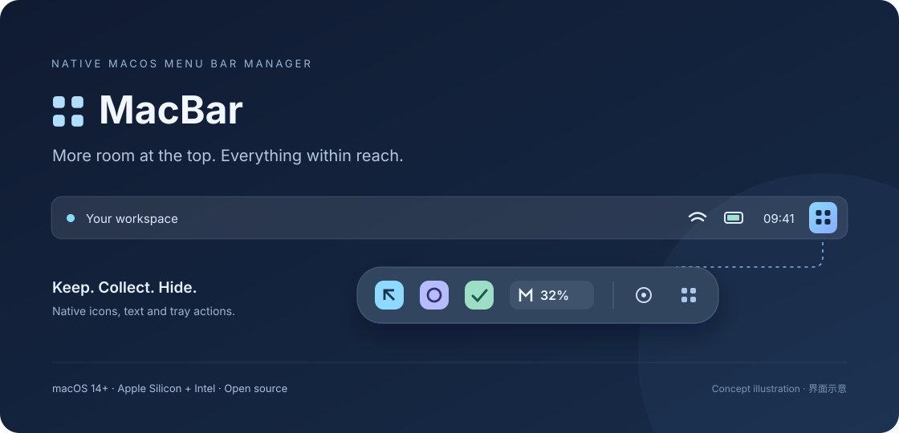

<div align="center">


# MacBar

**A little more room in your Mac's menu bar.**

Native macOS menu bar management, built with Objective-C and AppKit.

[](https://github.com/cold-summer/macbar/actions/workflows/ci.yml)
[](docs/installation.md)
[](LICENSE)

[Download](https://github.com/cold-summer/macbar/releases) · [Report an issue](https://github.com/cold-summer/macbar/issues/new/choose) · [简体中文](README.md)



</div>

MacBar moves less-used menu bar items into a floating collection panel. Keep your essentials at the top, reopen applications from the panel, or interact with their native tray menus. **Screen capture is off by default. MacBar manages existing menu bar status items, not every running application's Dock icon.**

> **Preview software:** Version 2.5.2 has 117 regression assertions and limited hands-on validation. Compatibility across every app, macOS version, display arrangement and full-screen mode has not been established. Menu bar manipulation uses private window APIs and may be affected by system updates.

## Features

- Three placements: **menu bar**, **MacBar panel**, and **hidden**, with reversible settings.
- Optional native icons and dynamic text with automatic background contrast. Capture requires explicit opt-in, runs only while the collection panel is visible, and triggers macOS's capture indicator.
- Generic click handling: left-click reopens normal applications; right-click forwards their native tray action. Agent-style utilities keep native left-click behavior.
- No application allowlist. Routing uses activation policy and application metadata; apps control what reopening actually displays.
- Persistent collection order, display-aware window identity and bounded restoration retries.
- No third-party runtime dependencies, telemetry, account system or in-app network requests.

The current application interface is in Simplified Chinese.

## Install

Requires **macOS 14+**. Release ZIPs contain Apple Silicon and Intel slices.

1. Download the universal ZIP from [Releases](https://github.com/cold-summer/macbar/releases).
2. Extract and move `MacBar.app` into `~/Applications` or `/Applications`.
3. Open MacBar and use the **辅助功能权限** button to grant Accessibility access.
4. No Screen Recording access is needed by default. To preserve native pixels and text, explicitly enable **原样图标（会触发录屏提示）** and grant access. Reopen the app if macOS requests it.
5. Left-click the four-square menu bar button to open the panel; right-click for settings and recovery actions.

Release binaries are ad-hoc signed and **not Apple-notarized**. macOS may block the first launch. Verify the source and checksum, then use macOS's per-app **Open Anyway** flow. Do not disable Gatekeeper globally.

Accessibility controls icon movement and click forwarding. Discovery, app reopening and icon movement do not require Screen Recording. Native pixel capture is off by default, including after upgrading from 2.5.0, and needs a fresh opt-in. Closing the panel stops capture calls. Logs stay local and may contain application names and window identifiers; review them before sharing.

Launching an app does not necessarily create a status item. Dock icons and the application menus on the left side of the menu bar are different from status icons on the right. Apps without a status item are not added to the collection automatically.

## Build

Install Xcode Command Line Tools, then run:

```bash
git clone https://github.com/cold-summer/macbar.git
cd macbar
./scripts/test.sh
./scripts/build.sh
./scripts/install.sh
```

The installer tests, builds, backs up the old app and installs to `~/Applications`. It does not launch the application. Builds use a configured signing identity, an existing `MacBar Local Codesign` identity, or ad-hoc signing as a fallback. Keep the same identity and installation path when updating to reduce permission resets.

```bash
MACBAR_SIGN_IDENTITY="Your Code Signing Identity" ./scripts/install.sh
MACBAR_SIGN_IDENTITY=- ./scripts/package.sh
```

The packaging script builds a universal app and produces a ZIP with a SHA-256 checksum in `dist/`. No developer certificate is needed for a local ad-hoc build.

## Recovery and limitations

Right-click MacBar's menu bar button and choose **展开全部顶栏图标** to reveal everything, including items configured as hidden. **重新应用布局** reapplies your saved placements. Native menu restoration stops after three unsuccessful attempts rather than moving icons indefinitely.

Some system items cannot be moved. Agent-only apps that also have a main window may continue using native tray actions. Multi-display copies, auto-hidden menu bars, full-screen spaces and unusual third-party menus can require additional compatibility work. A forwarded click receipt is not proof that the intended interface opened.

See the Chinese [installation guide](docs/installation.md), [compatibility notes](docs/compatibility.md), [troubleshooting guide](docs/troubleshooting.md) and [architecture](docs/architecture.md). Contributions and localization improvements are welcome; read [CONTRIBUTING.md](CONTRIBUTING.md).

## License

**GPL-3.0-or-later**. Window capture and event-handling portions reference and adapt work from [Ice](https://github.com/jordanbaird/Ice), copyright Jordan Baird. See [LICENSE](LICENSE) and [NOTICE](NOTICE). This repository is maintained independently of Ice and Apple.
