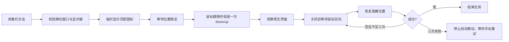

# 工作原理

MacBar 是直接通过 Clang 构建的 Objective-C / AppKit 应用，无 Xcode 工程或第三方运行库。

## 文件布局

```text
main.m                AppKit 界面、窗口扫描、图标移动、原生点击和恢复
MBPolicy.h / .m       身份、几何、图像、点击路由与恢复判定函数
Info.plist            应用身份、版本与最低系统要求
assets/AppIcon.svg    应用图标矢量母版
tests/regression.m    模拟窗口及应用包的回归测试
scripts/              构建、测试、安装和发布打包
.github/workflows/    CI 与预览版发布
```

构建时 `scripts/make-icon.sh` 将矢量母版转换为标准多尺寸 `.icns`，通过 `CFBundleIconFile` 声明供 Spotlight、访达和系统信息使用；该资源不涉及屏幕捕获。

## 图标身份与配置

窗口 ID 用于识别本次运行的确切目标；持久配置使用应用 bundle ID 加稳定 AX 标识。单图标应用可使用稳定的 primary 身份。无法区分的多个图标保持在顶部，不按宽度、动态标题或位置猜测。

设置使用 `MBTopOrderV2`、`MBBarOrderV2` 和 `MBHiddenOrderV2`，分别保存顶部、收集栏与不显示顺序。修改位置后验证结果，再持久化。bundle ID 保留为 `cc.icc.macbar`，便于已有本地用户升级。

## 点击流程

普通客户端左键通过 `NSWorkspace` 重新打开已运行的应用，不移动图标。运行类型和应用声明决定分类，不维护应用名单。原生动作则按以下流程执行：



点击事件和拖动事件采用不同的投递路径。事件回执用于诊断，不作为原生界面已打开的证明。菜单打开时不会因为固定超时被强制回收。

## 刷新与捕获

每 3 秒扫描菜单栏窗口。普通应用状态、文字、宽度和录屏指示变化不会触发整排布局；新收集项仅处理自身。扫描枚举系统登记的状态窗口，不将普通主窗口、应用菜单或 Dock 图标当成状态项。启动、明确的显示器变化或用户手动操作可应用完整布局。

默认使用应用图标，不调用图像捕获。可选原样模式要求 `MBNativeCaptureOptInV1` 和 `MBCaptureIcons` 均开启、系统权限允许且收集栏可见，才会从确切窗口 ID 数组读取画面；旧版自动开启的偏好不会视作明确同意。画面保留原生宽度与 Retina 比例，裁去垂直菜单空白。失败时保留上次有效图像。白/黑前景决定背景对比度，品牌色不参与投票，图像不重新染色。

## 权限和限制

移动需要 Accessibility，捕获需要 Screen Recording。所有数据本地处理。部分窗口查询和事件处理依赖私有接口；源代码公开不代表这些接口受到系统稳定性保证。

底层处理参考了 Ice，许可和具体来源见 [NOTICE](../NOTICE)。测试通过模拟依赖验证核心契约，真实的跨进程交互仍需要人工实机验证。
